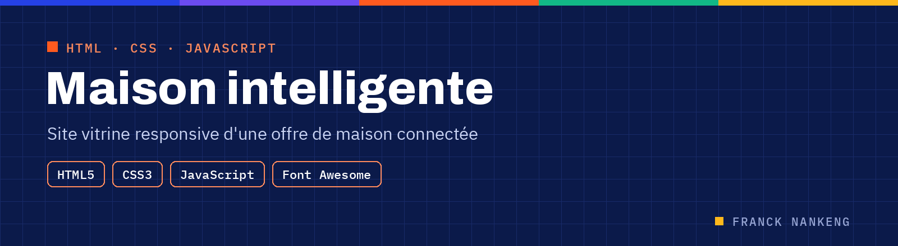

  
  
  
  

# Maison intelligente · site vitrine

**Franck Nankeng** · Projet académique · [LinkedIn](https://www.linkedin.com/in/franck-nankeng-51b43b297/)

Site vitrine responsive présentant une offre de maison connectée, organisé en sections : à propos, services, réalisations, équipe et contact.

| Ordinateur | Mobile |
|---|---|
|  |  |

## Stack
HTML5, CSS3, JavaScript, Font Awesome.

## Voir le site
Ouvrir `Smart_house_main/index.html` dans un navigateur, ou activer GitHub Pages sur ce dépôt.

---
*English — Responsive showcase website for a smart-home offer, built with HTML, CSS and JavaScript.*

---

### Autres projets

| [**Groupe Orvane**](https://github.com/Nganou1/orvane-powerbi) | [**Horizon_Contrat**](https://github.com/Nganou1/horizon-contrat-excel) | [**Process mining achats**](https://github.com/Nganou1/process-mining-achats) | [**Projets IA & ML**](https://github.com/Nganou1/projets-ia) |
|---|---|---|---|
| Power BI · 143 mesures DAX · RLS | Excel expert · Power Pivot · VBA | Python · PM4Py · audit SI | Python · machine learning · deep learning |

[Tous mes dépôts](https://github.com/Nganou1?tab=repositories) · [LinkedIn](https://www.linkedin.com/in/franck-nankeng-51b43b297/)
